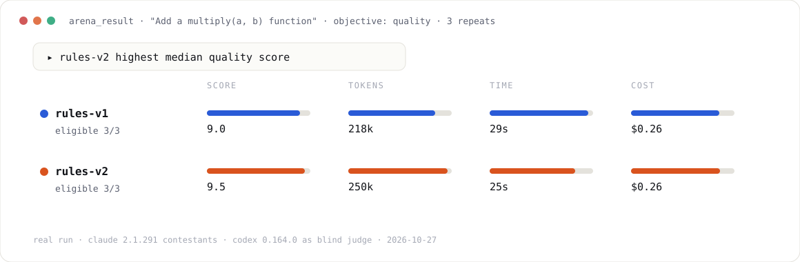
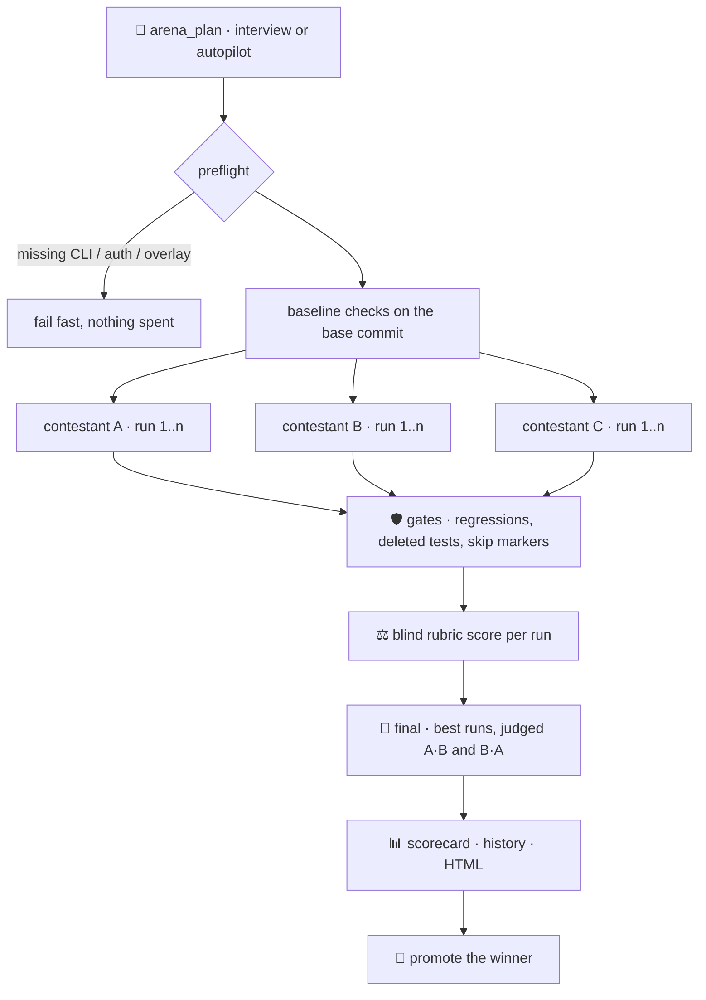

<div align="center">

<picture>
  <source media="(prefers-color-scheme: dark)" srcset="docs/assets/hero-dark.svg">
  
</picture>

**Stop guessing which agent, model, prompt or skill is better. Run the experiment.**

[](https://github.com/MatteoSava/agents-arena-mcp/actions/workflows/ci.yml)
[](https://modelcontextprotocol.io)
[](https://python.org)
[](LICENSE)

[Quick start](#quick-start) · [How it works](#how-it-works) · [Can you trust the judge?](#can-you-trust-the-judge) · [Spec reference](#spec-reference) · [Design](docs/design.md)

</div>

---

Agents Arena is an **experiment bench for coding agents**. It runs as an MCP server, so your agent drives it, and also as a CLI.

1. You describe a task and a few **contestants**, for example Claude vs Codex, skill v1 vs v2, or "minimal fix" vs "test-first".
2. Each contestant runs the task several times. Every run gets **its own git worktree** and, optionally, **a clean harness home** with none of your personal config in it.
3. Every run is checked against your base commit, so only regressions count against it.
4. A judge scores every run **blind**, then compares the best runs in a final judged **in both orders**, so position bias can't decide the result.
5. You get a **scorecard** with quality, tokens, time and cost, and you can ship the winner as a branch.

<picture>
  <source media="(prefers-color-scheme: dark)" srcset="docs/assets/scorecard-dark.svg">
  
</picture>

<sub>A real scorecard, not a mockup: two `CLAUDE.md` variants, 3 Claude runs each, judged blind by Codex.</sub>

## Four questions it answers

| You want to know… | Vary | Objective |
|---|---|---|
| **Which harness is best on *my* repo?** | `harness`: claude, codex, opencode | `quality` |
| **Did my skill / `CLAUDE.md` edit actually help?** | one overlay file, same harness and model | `quality` or custom rubric text |
| **Which setup is fastest or cheapest?** | anything | `speed`, `tokens` or `cost` (no judge needed) |
| **What's the most elegant fix?** | `strategy`: "minimal patch", "push IO behind an adapter", … | `elegance` |

## Quick start

```bash
# 1. Give your agent the arena (Claude Code shown; any MCP client works)
claude mcp add agents-arena -- uvx --from git+https://github.com/MatteoSava/agents-arena-mcp@v0.3.0 agents-arena-mcp

# 2. Optional: teach your agents the workflow
uv tool install git+https://github.com/MatteoSava/agents-arena-mcp@v0.3.0
cd your-repo && agents-arena init --skills claude,codex
```

Then just ask:

```text
You:    arena: did my new retry skill help? Compare it with the old one, 3 runs each.
Agent:  → arena_plan(mode="interview")
        Clean harness or your real setup? Score on quality only, or tokens too?
        I found `uv run pytest -q`. Use it as the check?
You:    clean, quality, yes, judge with codex.
Agent:  → arena_start(spec)  … arena_status  … arena_result(html=true)
        skill-v2 won the final in both orders. Scorecard and report.html are ready.
You:    ship it.
Agent:  → arena_result(promote="branch")  ⇒  arena/<id>-skill-v2  (your checkout is untouched)
```

## How it works



Each run follows the same steps:
- **Isolate:** a fresh worktree at your base commit. A `clean` baseline also gets its own `HOME`, with only that harness's login copied in.
- **Overlay:** your files go into the worktree or the clean home. Overlays never count as the contestant's code.
- **Setup:** an optional `setup` command, such as `npm ci`. Its output doesn't count as the contestant's code either.
- **Run:** the agent works headless, and the arena records tokens, cost, turns and wall time.
- **Snapshot and check:** the result becomes a git commit, checks run, and gates are applied. The worktree is then deleted, leaving the commit and patch.

## Contestants

A contestant is **harness + model + baseline + overlays + strategy**.

| | `real` baseline | `clean` baseline |
|---|---|---|
| What the agent sees | your skills, plugins, MCP servers, global `CLAUDE.md` | only the built-ins plus your overlays |
| Good for | "which setup works best *for me*" | controlled A/B tests of skills and instructions |
| Your home | used as-is (the harness still records its usual history) | never touched; the run gets a fresh `HOME` |
| claude auth | your keychain login | `CLAUDE_CODE_OAUTH_TOKEN` (`claude setup-token`) or `ANTHROPIC_API_KEY` |
| codex auth | your login | `auth.json` copied into the clean home |
| opencode auth | your stored logins | env-keyed providers only (e.g. `OPENROUTER_API_KEY`); always set `model` |

> [!TIP]
> **A/B testing instructions? Use `clean`.** In a real run, a `CLAUDE.md` A/B showed *no* difference. The user's global `~/.claude/CLAUDE.md` (TDD, keep a TODO.md) shaped every run more than the file under test did.

## Can you trust the judge?

Judging is where comparisons usually go wrong, so the arena measures its own judge. `agents-arena eval-judge` runs 8 seeded pairs with known answers through the real judging path:
- a correct fix vs a no-op
- a test-deleting cheat
- a skip-marker cheat
- a hard-coded special case
- an API break
- verbose vs minimal
- a near-identical pair

| Judge (measured 2026-10-27) | Accuracy | Order-flip rate | Picks label "A" |
|---|---:|---:|---:|
| codex 0.164.0 | **87.5%** | **0%** | 50% |
| claude 2.1.291 | **87.5%** | **0%** | 50% |
| opencode · openrouter/openai/gpt-5-mini | 75% | 12.5% | 44% |

A position-biased judge would pick "A" much more than 50% of the time, and its verdicts would flip when A and B are swapped. Every final is judged in both orders, and a split verdict counts as a tie, never as a win.

```bash
agents-arena eval-judge --judge codex
agents-arena eval-judge --judge claude --model sonnet
```

## Guardrails

Gates run on every patch before judging:

| | |
|---|---|
| ⛔ **Disqualified** | no changes · agent timed out · deleted a test · touched CI or `.agents-arena/` · broke a check that passed on the base commit |
| ⚠️ **Flagged for you** | agent exited non-zero · edited agent config (`.claude/`, `AGENTS.md`…) · secret-looking paths · test config changes · added skip/xfail markers · `assert True` |
| ℹ️ **Noted** | edited an existing test · check already failing on the base commit |

Build artifacts (`__pycache__`, `.pytest_cache`, `node_modules`, `.venv`, tool caches) are never counted as part of a solution.

<details>
<summary><b>Spec reference</b></summary>

<a id="spec-reference"></a>

The MCP call takes JSON, and the CLI takes TOML or JSON with the same structure. Unknown keys are rejected, so a typo fails loudly. Contestant names and check names must be unique, and a spec can have 1 to 6 contestants.

```toml
task      = "Make retries respect the Retry-After header"
objective = "quality"   # quality | elegance | speed | tokens | cost | any rubric text
repeats   = 3
setup     = "uv sync"   # runs on the base commit and in every run's worktree

[[checks]]
name = "tests"
cmd  = "uv run pytest -q"

[[contestants]]
name     = "skill-v1"
harness  = "claude"     # claude | codex | opencode | command
baseline = "clean"      # clean | real
strategy = ""           # optional approach, added to the brief

  [[contestants.overlays]]
  from = "~/skills/retry-v1/SKILL.md"
  to   = "repo:.claude/skills/retry/SKILL.md"   # or home:<path> (clean only)

[[contestants]]
name     = "skill-v2"
harness  = "claude"
baseline = "clean"

  [[contestants.overlays]]
  from = "~/skills/retry-v2/SKILL.md"
  to   = "repo:.claude/skills/retry/SKILL.md"

[judge]
harness = "codex"       # prefer a different model family than the contestants
```

| Field | Default | |
|---|---|---|
| `base_ref` | `HEAD` | commit or branch to start from |
| `max_parallel` | `4` | concurrent runs |
| `run_timeout_sec` | `1800` | per agent run; a timeout disqualifies the run |
| `check_timeout_sec` | `600` | per check and for `setup` |
| `judge.model`, `judge.timeout_sec` | harness default, `600` | |

**Winners:**
- **Judged objectives:** the contestant whose best run wins the final in both orders. Otherwise, the highest median rubric score. If that's still a tie, you decide.
- **Metric objectives:** the lowest median among eligible runs.

</details>

<details>
<summary><b>Tools and CLI</b></summary>

| MCP tool | CLI | |
|---|---|---|
| `arena_plan(request, mode)` | `agents-arena plan "…" --mode autopilot` | Draft a spec from detected checks, setup and installed harnesses. Runs nothing |
| `arena_start(spec, wait)` | `agents-arena start spec.toml` | Preflight, then run everything. Over MCP, `wait=false` runs it in the background |
| `arena_status(arena_id)` | `agents-arena status` | Per-run state, exit status, eligibility and job progress |
| `arena_result(arena_id, html, promote)` | `agents-arena result --html --promote branch` | Scorecard and report. `promote`: `patch`, `branch` (no checkout), or `apply` (only if it applies cleanly) |
| `arena_history(contestant, task_contains, limit)` | `agents-arena history` | Past results, newest first |
| resource `arena://guide` | `agents-arena init --skills …` | The workflow guide, as a resource or as an installed skill |
| | `agents-arena eval-judge --judge …` | Measure a judge (see above) |

The CLI always waits for a run to finish, because a background run would die when the CLI process exits. Use the MCP server for background runs. Arena state lives in `.agents-arena/`, which ignores itself in git, and history is kept in `.agents-arena/history.jsonl`.

</details>

<details>
<summary><b>Trust model and platform support</b></summary>

- Contestants and checks run agent-written code on your machine with your privileges, the same as running `make test` on an untrusted branch. Worktrees isolate files, not processes.
- A `real` contestant has your usual config and credentials.
- Check and setup commands come only from the spec. Judges run in a temporary directory outside your repo.
- macOS and Linux are supported. Windows, network filesystems, git submodules and Git LFS are not.
- Verified with claude 2.1.291, codex-cli 0.164.0 and opencode 2.1.4. CLI flags and output formats are what change between versions. Each harness's isolation recipe is in [docs/v0.3-isolation-spike.md](docs/v0.3-isolation-spike.md).

</details>

## Development

```bash
uv sync
uv run pytest -q
uv run ruff check . && uv run ruff format --check . && uv run basedpyright
```

Architecture, data layout and selection logic are described in [docs/design.md](docs/design.md). What's next is in [TODO.md](TODO.md). MIT licensed.
